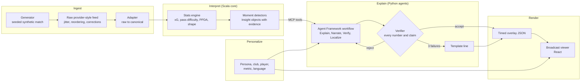

# Football Decipher Live: a synthetic match intelligence engine

An AI pipeline that turns a live stream of football events into match intelligence you can check: overlays on the broadcast, short narratives that say why a moment matters, and a full-time recap. Each viewer gets their own version by persona, favourite club or player, metric and language (English, Hindi, Spanish).

All data is synthetic. All clubs and players are fictional.

## The problem

A live match produces thousands of events, and most viewers see only the score and a few replays. The numbers that explain a match (a press that is winning the ball back, a team that has dropped ten metres deeper to protect a lead, the pass that opened the defence) are there in the data but never reach most fans. Analysts want them in full; a casual fan wants the story in plain words.

Large language models can write that story, but they invent numbers. Here the rule is simple: **code computes every fact, the model only explains facts that tools return, and a verifier checks every number and claim before anything reaches the screen.**

## How it works



The five stages:

1. **Ingest.** A seeded generator plays a 90-minute match from a scenario script (team styles, a high-press spell, soft story beats such as a counter-attack goal). A feed emulator turns it into a messy provider-style raw feed, with latency, out-of-order delivery, corrections, phantom events and a dropout. An adapter turns that back into the canonical schema and reports every repair. The same seed always gives byte-identical output.
2. **Interpret.** A pure Scala stats engine enriches events (xG from distance and angle, expected pass completion, progressive passes, zones) and keeps per-minute aggregates that corrections update. Moment detectors (goals, red cards, key chances, momentum swings, pressing, control against chaos, tempo, key passes, changes of team shape) emit **Insight** objects. Each one carries facts, the evidence event IDs, a reason code and an importance score, with no prose. Every fact can be re-derived from its evidence events, and a test proves it.
3. **Explain.** A Microsoft Agent Framework workflow reaches the data only through a thin MCP server over the core's tool endpoints. It builds a fact sheet, writes the line and verifies it. Localization to Hindi and Spanish is verified again. A rejected line goes back with the reasons, and after three failures a template line is used instead.
4. **Render.** Overlays are timed JSON (`t_start_ms`, `duration_ms`). The viewer runs 10 s or more behind the live feed, so the narration is ready before the moment reaches the screen. A quick verified template card shows first, and the model's line replaces it in place. Corrections retract cards on screen. At the final whistle a recap card sums up the match: the result and what decided it, from the engine's own count of the match's events.
5. **Personalize.** One language-neutral insight is narrated per persona and language on demand, then cached. Casual fans, club fans and player-focus viewers get plain words and the story moments. Analysts and metric-focus viewers get the technical lines and shape maps. Signed-in users keep their preferences.

See [docs/architecture.md](docs/architecture.md) for the components and data flow, and [docs/decisions.md](docs/decisions.md) for the decision records (ADR-001 to ADR-021).

## Microsoft and Azure services used

| Service | What it does here |
|---|---|
| Microsoft Foundry (gpt-5-mini) | Explains, narrates and localizes moments; AI-judged evaluations (groundedness, relevance, coherence, fluency) in the eval gate |
| Microsoft Agent Framework | The narration workflow graph: gather, explain, personalize, narrate, verify, localize, publish |
| Model Context Protocol (official SDK) | The only way agents reach match data: one tool per core endpoint |
| Azure Container Apps | The Scala core, the agent service and a generator job |
| Azure Event Hubs | The live match feed between the generator and the core |
| Azure Cosmos DB (serverless) | Insights, overlays, shared narrations and user preferences |
| Azure Static Web Apps | The broadcast viewer |
| Azure App Configuration | Settings changed in the portal during a demo, applied within about 2.5 minutes with no redeploy |
| Microsoft Entra ID | Viewer sign-in (MSAL); the APIs accept an Entra token or a service API key |
| Azure Key Vault and managed identity | The API key and connection strings; no keys in the repo or app settings |
| Application Insights | Tracing for the core (Java agent) and the agents (OpenTelemetry) |
| Azure Developer CLI, Bicep, GitHub Actions | One-command provisioning; CI and a deploy pipeline that ends with the online eval gate |

## Trust: how a number reaches the screen

- **Facts in code.** Detectors compute every number. An insight's facts are re-derived from its evidence events in tests.
- **Tools, not dumps.** The workflow calls a fixed set of MCP tools per insight kind. No bulk events or tracking frames reach a prompt.
- **Verifier.** It checks every number in a line against the fact sheet (in digits, words, Devanagari and percentages), every name against the insight, and every event claim (penalty, red card, equaliser, counter) against the evidence. Lines for plain personas may not use xG, PPDA or decimals.
- **Eval gate.** Every deploy replays the demo match and narrates 12 moments in 5 personas and 3 languages (180 lines). An independent checker requires a 100% number match and 100% verified lines, and Foundry evaluators score groundedness, relevance, coherence and fluency. A regression fails the build.

## Run it locally

Toolchain: JDK 25, sbt 1.13, Python 3.13, Node.js 22 LTS.

```bash
# 1. Core (Scala): API on http://127.0.0.1:8080
cd core && sbt run

# 2. Agent service (Python, offline stub model): http://127.0.0.1:8090
cd agents && python -m venv .venv && .venv/Scripts/python -m pip install -e ".[dev]" -r ../schema/requirements.txt
.venv/Scripts/python -m smi_agents serve

# 3. Viewer (React): http://127.0.0.1:5600
cd web && npm install && npm run dev
```

On macOS and Linux, use `.venv/bin/python`. Open the viewer, open the Match panel and press Start. The demo match is seed 154: an away counter-attack goal, a home high press from 55 to 70 minutes, a home red card, a ten-man equaliser, and a 2-2 finish. Use `SMI_MODEL=foundry` with `AZURE_AI_PROJECT_ENDPOINT` set to narrate with a Foundry deployment instead of the stub.

Other useful commands:

```bash
cd core && sbt "generate --seed 154"     # a match as NDJSON
cd core && sbt "insights --seed 154"     # the ranked moments
cd core && sbt calibrate                 # 200 seeds against the plausibility bands
```

## Tests

```bash
cd core && sbt test                                               # Scala: golden files, invariants, engine, detectors, API, auth
cd agents && .venv/Scripts/python -m pytest                       # Python: workflow, verifier, templates, MCP, auth
agents/.venv/Scripts/python eval/run.py --offline                 # the eval gate on recorded answers
cd web && npm test && npm run typecheck                           # viewer: library, controller, components
cd web && SMI_PYTHON=../agents/.venv/Scripts/python npm run e2e   # Playwright parity suite against the real services
```

CI runs all of them on every push.

## Deploy to Azure

Needs an Azure subscription with a gpt-5-mini quota in East US 2, the Azure CLI, the Azure Developer CLI and Docker.

```bash
az login && azd auth login
sh infra/scripts/entra-apps.sh <viewer url>   # once: the two app registrations for sign-in (optional)
cd core && sbt assembly && cd ..
azd up                                        # provision everything and deploy the three services
```

Without the app registrations the APIs stay open and the viewer runs without sign-in. Run `azd down --purge` to remove everything.

### Branches and releases

- Work happens on feature branches (`feature/...`). Each one reaches `master` through a pull request. CI runs on every push and pull request, and the **PR policy** check fails any pull request that does not go from `feature/...` into `master`.
- To deploy, run the **Promote master to release** workflow (Actions tab, or `gh workflow run "Promote master to release" -f bump=patch`). It fast-forwards `release` to the latest `master` and starts the deploy. It refuses to run when `release` has commits that are not on `master`, and only the repository owner may run it.
- Guardrails (rulesets in `infra/github/rulesets`, applied with `sh infra/scripts/github-rulesets.sh`):
  - `master` takes changes only through pull requests that pass the PR policy check and CI, and can't be deleted or force-pushed.
  - Only the Promote workflow can update `release`.
  - The repository admin can bypass both rulesets.
  GitHub enforces rulesets on public repositories, or on private ones with a paid plan.
- The Deploy workflow (`.github/workflows/azure-dev.yml`) runs for `release` only. It provisions with azd, deploys the core, the agents and the viewer, checks the live core with read-only requests, and runs the online eval gate. The eval replays the demo match on a core of its own on the runner, built from the same jar as the core image, and narrates with the real Foundry model, so matches on the live site can go on during a deploy.
- When the gate passes, the workflow tags the commit and creates a GitHub Release with the eval scores and notes generated from the commits. The first tag is `v1.0.0`. Each later deploy bumps the patch version; run the workflow by hand to bump the minor or major version instead.
- Azure trusts only the `release` branch. The deploy signs in with OIDC (repository variables `AZURE_CLIENT_ID`, `AZURE_TENANT_ID`, `AZURE_SUBSCRIPTION_ID`, `AZURE_ENV_NAME`, `AZURE_LOCATION`), and its federated credential names `refs/heads/release`. Pushes to `master` and pull requests cannot get Azure tokens.

## Path to production: the adapter

The pipeline never reads the generator. It reads canonical envelopes that the adapter produces from a provider-style raw feed: numeric type and qualifier IDs, 0 to 100 coordinates, minute and second clocks, upserts and deletes. That raw format is our own invention, and nothing in it comes from a real provider. To use a real data provider, you would write one more adapter for its format behind the same canonical schema. The engine, detectors, agents, verifier and viewer stay as they are. The adapter already handles what real feeds do: late and out-of-order events, corrections that retract and replace insights, and missing qualifiers.

## Layout

| Folder | Contents |
|---|---|
| `schema` | JSON Schemas (the source of truth), examples, known-bad cases |
| `core` | Scala 3: generator, raw feed and emulator, adapter, stats engine, detectors, HTTP and SSE API |
| `agents` | Python: Agent Framework workflow, MCP server, verifier, templates, narration service |
| `web` | The broadcast viewer (React, TypeScript, Vite) |
| `config` | Default settings (`app.yaml`), overridden by Azure App Configuration |
| `infra` | Bicep, azd hooks, the app registration script |
| `eval` | The eval gate, its thresholds and baseline |
| `docs` | Architecture, decision records, calibration report, demo script |
