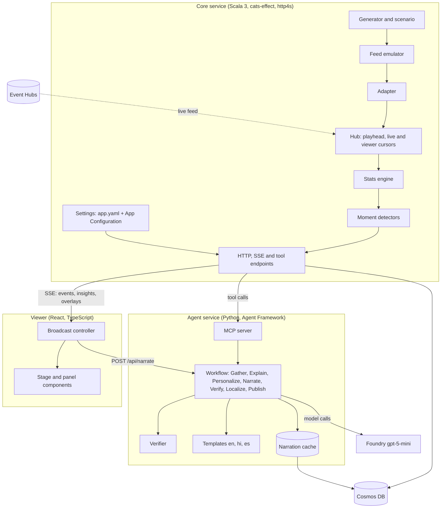
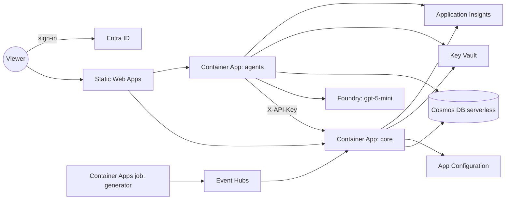

# Architecture

Football Decipher Live turns a stream of synthetic football events into verified, personalised match intelligence. This page covers the components, the contracts between them, how one moment travels from an event to a card on screen, and how it runs on Azure. The reasons behind each choice are in [decisions.md](decisions.md).

## Principles

- **Code computes facts. The model only explains them.** Every number in generated text must be checkable against the engine.
- **Agents reach data only through MCP tools.** No bulk events or tracking frames in a prompt.
- **One insight, many narrations.** An insight is language-neutral. It is narrated per persona and language on demand and cached by (insight, persona, language).
- **Verify, retry, fall back.** The Verifier checks every line. A rejected line is retried with the reasons. After three failures a template line is used instead.
- **Synthetic, deterministic data.** The same seed gives byte-identical output, so the demo, the tests and the eval gate all see the same match.

## Components



| Component | Folder | Role |
|---|---|---|
| Generator | `core/.../generator` | Seeded possession-by-possession match from a scenario: team styles, tactical phases, soft story beats. Generator-only player attributes never reach the pipeline. |
| Feed emulator and adapter | `core/.../raw` | The emulator delivers a provider-style raw feed with jitter, reordering, corrections, phantoms and a dropout. The adapter rebuilds canonical envelopes and reports every repair. |
| Hub | `core/.../api` | One match at a time. The live cursor feeds the engine; the viewer cursor trails it by `delay_s` of match time. It plays either a replay or a bus (Event Hubs). |
| Stats engine | `core/.../engine` | Pure. Enrichment (xG, expected pass completion, progressive passes, zones), per-minute aggregates that corrections update, and a metric registry with capability levels and basis tags. |
| Detectors | `core/.../insight` | Find moments, derive facts from evidence alone, attach the match context (score, players on the pitch, minutes left) and score importance. Corrections retract and replace insights. |
| MCP server | `agents/.../mcp_server.py` | A thin layer: one tool per core tool endpoint. The core's JSON is returned unchanged. |
| Workflow | `agents/.../workflow.py` | An Agent Framework graph. Code chooses which tools to call, so the fact sheet is fixed before the model sees anything. |
| Verifier | `agents/.../verifier.py` | Numbers, names, event claims, technical terms for plain personas, lengths, script (Devanagari for Hindi). |
| Viewer | `web/src` | A framework-free controller (`broadcast.ts`) publishes immutable snapshots; React renders them. It computes no match facts. |

## Contracts

The JSON Schemas in `/schema` are the source of truth. Scala models are hand-written and pinned by golden round-trip tests. Python models are generated from the schemas.

- **Canonical envelope** (`canonical.schema.json`): `match_meta`, `lineup`, `event`, `tracking_frame` or `delete`. Pitch 105 x 68 m, team-relative coordinates (each team attacks toward x = 105), clocks `period`, `period_clock_s`, `match_clock_s`, `wallclock_utc` and `video_ts_ms`.
- **Insight** (`insight.schema.json`): `facts`, `evidence_event_ids`, `why_it_matters {code, params}`, `importance`, `basis`, `capability_level`. No prose.
- **Overlay** (`overlay.schema.json`): a timed graphic (`t_start_ms`, `duration_ms`) with `op` show or retract: insight cards, scoreline updates and shape maps.

Data has three layers: raw events, then enriched values (xG, pass difficulty, progressive), then insights. Derived metrics never go into the raw layer. Each metric declares the capability level it needs (0 events only, 1 coarse tracking, 2 detailed windows) and a fallback, and each output carries its basis.

## One moment, end to end

```mermaid
sequenceDiagram
  participant H as Hub (live cursor)
  participant D as Detectors
  participant V as Viewer
  participant A as Agent service
  participant M as MCP tools
  participant F as Foundry
  H->>D: event (live side)
  D->>V: insight over SSE, ahead of the viewer
  V->>A: narrate (mode template)
  A-->>V: verified template line, at once
  V->>A: narrate (mode model)
  A->>M: get_insight, match_info, team_stats
  M-->>A: fact sheet
  A->>F: explain, narrate
  F-->>A: draft line
  A->>A: verify, retry with reasons, localize, verify
  A-->>V: verified model line
  Note over V: the viewer clock reaches t_start_ms
  V->>V: show the card; the model line replaces the quick line in place
```

Timing:
- The viewer runs `delay_s` of match time behind the live feed.
- The Start form suggests 12 s of real time for the model (`delay_s = speed x 12`, between 30 and 600 s).
- Moments of importance 0.5 and up get the model line in the lower third.
- Moments from 0.35 to 0.5 get a template corner card. Moments below 0.35 go to the ticker only.

Corrections:
- A correction that changes an insight's evidence makes the core re-check that insight.
- If the facts changed, the old insight is retracted and a replacement is published.
- A card already on screen is struck through and withdrawn.

## Personas

| Persona | Moments | Words | Metric chips |
|---|---|---|---|
| Casual | goals, red cards, big chances, key passes, momentum swings | plain | 1 count |
| Club fan | everything about their club, plus the opponent's goals and red cards | plain, from the club's side | 1 count |
| Player focus | moments naming the player, plus goals and red cards | plain | 1 count |
| Metric focus | moments carrying the chosen metric, plus goals and red cards; shape maps | technical | 3 |
| Analyst | every moment and the shape maps | technical, with the basis | 4 |

The viewer narrates only what a persona sees. The Verifier rejects xG, PPDA and decimal numbers in plain lines.

## On Azure



- **Identity.** One user-assigned managed identity holds only the roles it needs. Local auth is off where the service allows it. The API key lives in Key Vault and reaches the apps as a Container Apps secret.
- **Access.** People sign in with Entra ID and send a token. Services send the API key. `/health`, `/openapi.yaml` and `/api/config` stay public. Sign-in can be switched off in App Configuration for an open demo.
- **Settings.** `config/app.yaml` holds the defaults, and App Configuration overrides them. The core reads the store every 2 minutes and serves the values in effect at `/api/config`. The agents and the viewer follow within about 2.5 minutes.
- **Pipeline.**
  - CI on every push: core, agents and offline eval, viewer unit tests, Playwright parity.
  - Deploy on push to master: build the images on the runner, `azd provision`, `azd deploy`, build the viewer, then run the online eval gate against the deployed core and Foundry.

## Quality gates

| Gate | What it checks |
|---|---|
| Golden tests | Every schema example round-trips; every known-bad case is rejected, in Scala and Python |
| Invariants | Monotonic sequence and clocks, spatial continuity, score equals goals, players minus red cards |
| Calibration | 200 seeds inside plausibility bands (goals, shots, passes, completion, possession, fouls, events) |
| Rederive | Every insight's facts, reason and importance rebuilt from its evidence events alone |
| Verifier tests | Reject a wrong number, reject an unsupported claim, accept a correct line; every template line passes |
| Parity suite | The viewer end to end against the real core and agent service |
| Eval gate | 165 lines: 100% number match and verified; fallback, first-attempt and latency bounds; Foundry groundedness, relevance, coherence and fluency against a baseline |
